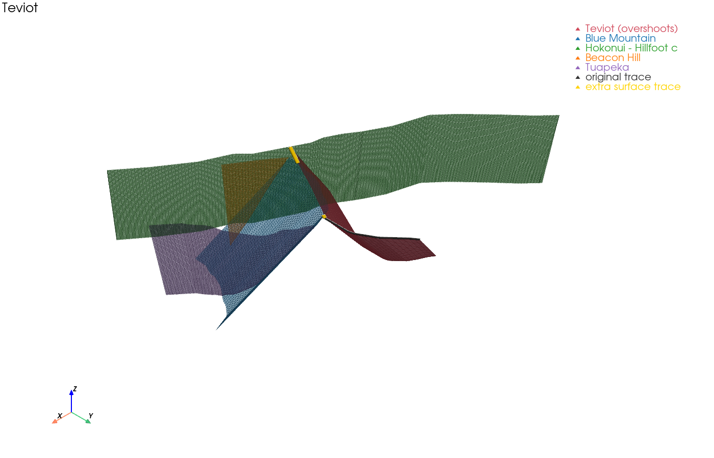
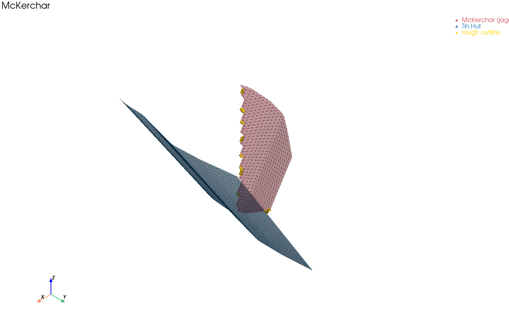

# Whole-model workflow without Leapfrog

The [central New Zealand tutorial](../tutorials/central_nz_no_leapfrog.ipynb) shows the individual Python steps that replace Leapfrog Geo: building a surface for each fault, cutting the surfaces against each other, and trimming them at the base of the seismogenic zone. For a full fault model, those steps are run as a script, and the results are checked and fixed by hand before the final remesh. This page describes that script and the two interactive review tools that go with it.

The scripts live in [`scratch/whole_nz_no_leapfrog/`](https://github.com/uc-eqgeo/cfm_leapfrog/tree/main/scratch/whole_nz_no_leapfrog) and are set up for the whole-of-New-Zealand Community Fault Model. To use them for another dataset, copy the folder and change the input file names at the top of `whole_nz_pipeline.py`.

All commands below are run from that folder, inside the `leapfrog-fault-models` conda environment (see [Installation](install.md)).

## The pipeline: `whole_nz_pipeline.py`

```
python whole_nz_pipeline.py
```

The pipeline builds the fault network once and then runs through the stages below. Each stage reads its inputs back from disk, so a later stage can be re-run without repeating an earlier one. For example, you can re-cut without rebuilding the raw surfaces. The parameters for each stage are constants near the top of the script.

| Stage | What it does | Writes |
|---|---|---|
| Fault network | Reads the traces, finds connections between segments, then applies the edited fault systems, cutting hierarchy and trace extensions | `suggested_trace_extensions.csv` / `.geojson` |
| 1. Build surfaces | Contours each curated fault to depth and triangulates it | `test_objs/`, `test_vtks/`, `test_contours/`, `merged_mesh_uncut.vtk` |
| 2. Cut surfaces | Cuts each fault against the higher-priority faults in the hierarchy, then trims it with the depth-of-faulting raster | `test_final_meshes/*_cut.obj`, `cuts_applied.csv`, `merged_mesh_cut.vtk` |
| 2b. Check cuts | Flags cut meshes that need a closer look (see below) | `surface_trace_check.csv` / `.geojson`, `jagged_cut_check.csv` / `.geojson`, `jagged_cut_blame.csv` / `.geojson` |
| 3. Remesh | Remeshes every cut surface into uniform, near-equilateral triangles with MMG | `test_remeshed_vtks/`, `merged_mesh_remeshed.vtk` |

The pipeline reads these inputs:

| File | Purpose | Required? |
|---|---|---|
| `NZ_CFM_v1_0_rs1km_modified_GDM.gpkg` | Fault traces and attributes (see [Preparing inputs](preparation.md)) | yes |
| `..._connected_edited.csv` | Which segments make up each fault (from the [connections tutorial](../tutorials/define_connected.ipynb)) | yes |
| `..._hierarchy_edited.csv` | Which fault cuts which | yes |
| `with_hannu_mods.tif` | Depth-of-faulting surface (z in metres, negative down) | yes |
| `edited_trace_extensions.csv` | Hand-edited trace extensions | no |
| `removed_trace_extensions.csv` | Extensions ruled out during review (subtracted from the file above) | no |
| `additional_cuts.csv` | Extra `cut,cutter` pairs to force | no |
| `excluded_cuts.csv` | `cut,cutter` pairs that must never be cut | no |

The last three files are where the decisions from the review tools are stored. The pipeline never overwrites them, so a rerun keeps every decision made so far.

### Stage 2b: automatic checks

The cutting logic (described in [Mesh cutting logic](mesh_cutting_logic.md)) handles most fault intersections, but not all of them. Stage 2b looks for two kinds of failure:

- **Surface-trace overshoots.** Trace extensions exist to give a fault enough area *below* the surface to reach its neighbours and be cut cleanly. They are not meant to survive at the surface. This check compares each cut mesh's outline at z = 0 with the original, un-extended trace. Any end that runs more than `TRACE_CHECK_FLAG_DISTANCE` (2 km by default) beyond the original trace is flagged. Either a cut that should have happened did not, or the extension was not needed.
- **Jagged cuts.** A cut that has gone wrong leaves a serrated or stair-stepped subsurface outline. This check walks each fault's subsurface outline and counts sharp kinks and direction reversals. Each rough stretch of outline is then blamed on the cut that most likely produced it, using `cuts_applied.csv` from Stage 2 if it is available. A flagged fault therefore comes with the name of the cut to revisit, not just a score.

The GeoJSON outputs contain only the offending geometry, so they can be laid over the traces in QGIS. To decide what to do about each flag, the 3-D review tools below are usually quicker.

## Manual review with PyVista

Two scripts step through the Stage 2b flags one at a time. Each opens an interactive [PyVista](https://docs.pyvista.org/) window showing the flagged fault next to the faults around it. Each surface is drawn semi-transparent with its triangle edges in its own colour. Rotate and zoom to inspect the geometry, then **close the window**. The terminal then asks what to do.

Decisions are written to disk as soon as they are made, and every reviewed item is recorded in a log. You can stop at any point (`q` or Ctrl-C) and pick up where you left off by running the script again. Both scripts share their viewer and file handling, which live in `review_common.py`.

### Surface-trace overshoots: `review_trace_extensions.py`

```
python review_trace_extensions.py                    # everything not yet reviewed
python review_trace_extensions.py --only Awakeri     # one fault
python review_trace_extensions.py --all              # start again from the top
```

For each flagged fault end, the view shows:

- the fault (red)
- its original trace (dark grey)
- the overshooting piece of surface trace (yellow)
- up to six candidate faults it may have been meant to terminate against

The candidates come from two sources. The first is the connection graph, which lists the higher-priority faults this one runs into. The second is any fault whose trace passes within 5 km of the overshoot. This catches cases the graph missed, which are often why the cut never happened.



The terminal lists the candidates with their distances. It also marks the expected terminations and any cut that has already been forced. The choices are:

| Key | Action | Recorded in |
|---|---|---|
| `1`–`6` (or e.g. `1,3`) | Force a cut of this fault by that candidate | `additional_cuts.csv` |
| `x` | Drop the trace extension at this end | `removed_trace_extensions.csv` |
| Enter | Leave it alone | `trace_review_log.csv` only |
| `r` | Show the view again | — |
| `q` | Stop | — |

### Jagged cuts: `review_jagged_cuts.py`

```
python review_jagged_cuts.py                  # everything not yet reviewed, worst first
python review_jagged_cuts.py --only Waitangi  # one fault
python review_jagged_cuts.py --all            # start again from the top
```

For each jagged fault, the view shows the fault (red), every fault blamed for part of its rough outline, and the rough stretches of outline (yellow). Pass `--uncut-cutters` to draw the cutting faults' raw surfaces instead of their cut ones. This helps when a cutter has itself been trimmed back.



The terminal prints the roughness scores, followed by one line per suspected cutter. Each line shows the number of rough segments, their median distance from the cutter, and whether `cuts_applied.csv` confirms that the cut happened. Rough segments that cannot be blamed on any fault, or that lie along the depth-of-faulting surface, are listed for information but cannot be excluded. The choices are:

| Key | Action | Recorded in |
|---|---|---|
| `1`–`n` (or e.g. `1,3`) | Stop that fault from cutting this one | `excluded_cuts.csv` |
| Enter | Leave it alone | `jagged_review_log.csv` only |
| `r` | Show the view again | — |
| `q` | Stop | — |

### Shared options

| Option | Effect |
|---|---|
| `--start-from FAULT` | Skip ahead to this fault |
| `--z-scale N` | Exaggerate the vertical axis of the 3-D view |
| `--screenshots DIR` | Save every view as a PNG in `DIR` without asking for decisions (useful for a quick visual pass or for reports) |
| `--include-unflagged` | (`review_trace_extensions.py` only) Also review overshoots below the flagging threshold |

## Putting it together

1. Run `whole_nz_pipeline.py`.
2. Review the flags with `review_trace_extensions.py` and `review_jagged_cuts.py`.
3. Run `whole_nz_pipeline.py` again. It picks up `additional_cuts.csv`, `excluded_cuts.csv` and `removed_trace_extensions.csv` and rebuilds the meshes.
4. Repeat steps 2–3 until Stage 2b has nothing left to flag. The review logs mean each pass only shows new or unreviewed items.
5. Inspect `merged_mesh_remeshed.vtk` in ParaView.
